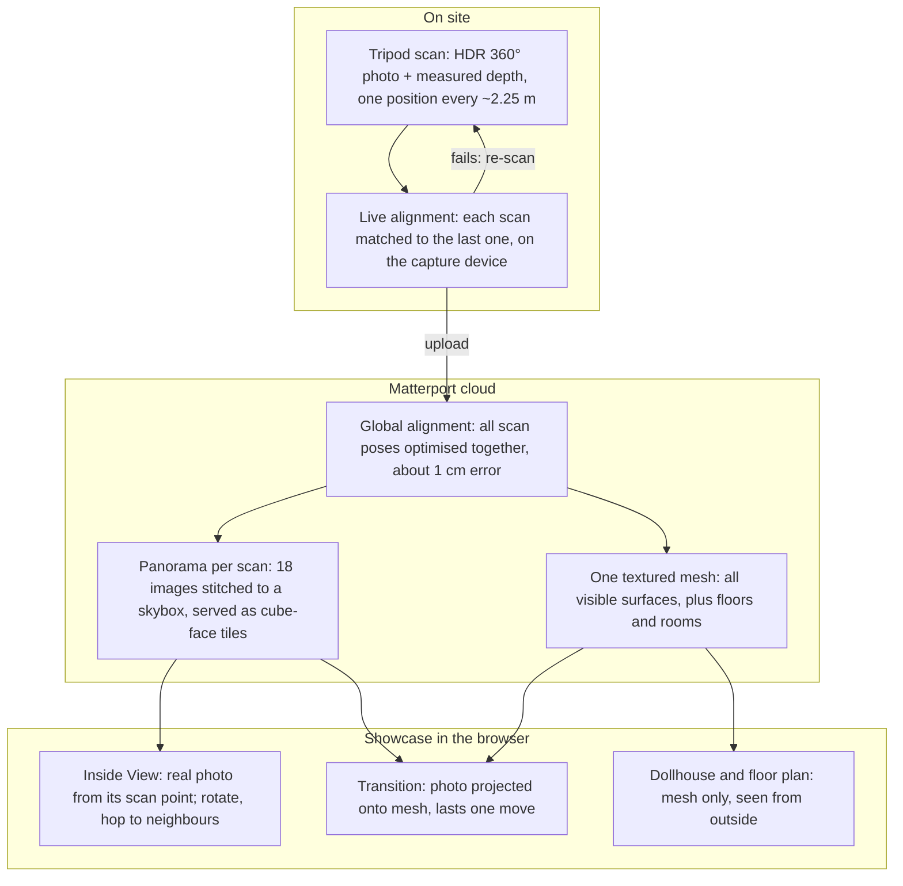

# Matterport teardown: how it works and what NammaSpace should borrow

Prepared: 24 November 2026. Live copy: [Claude Doc](https://claude.ai/artifact/S7aarSjtCLvPqHUthXLgXS).

## Scope and method

This is a teardown built only from public material. The goal is to learn how Matterport delivers a clean indoor walkthrough, so that NammaSpace can design its own pipeline, not copy Matterport's code or content.

- **Used:** Matterport's published developer documentation, product and hardware pages, granted patents, the peer-reviewed Matterport3D dataset paper, and behaviour anyone can see in the public Showcase viewer.
- **Not done:** no decompiling of Matterport apps or firmware, no bypassing of authentication or rate limits, and no downloading of hosted models. Matterport's terms restrict reverse engineering of its software, and NammaSpace does not need it.
- **Confidence:** each claim is marked as documented (from a cited source) or inferred (reasoned from behaviour). Sources are listed at the end.

It builds on the earlier note [namma-space-matterport-research.md](namma-space-matterport-research.md) and on the 24 November 2026 ghosting investigation of the NammaSpace classroom splat.

## System overview

Matterport splits a space into two products that never mix at rest: a photo per scan position, and one mesh for the whole space.

Alignment errors end up in the mesh. Visitors see the mesh only mid-move or from outside, so the photo they study at rest stays untouched.

## Capture hardware and sensing

Every professional Matterport capture records the same unit: a still, HDR 360° panorama plus measured depth, taken from one fixed point at roughly eye height. Nothing is learned from handheld video.

| Spec | [Pro3](https://matterport.com/cameras) | [Pro2](https://matterport.com/cameras) |
| --- | --- | --- |
| Depth sensing | Lidar, 904 nm, Class 1 laser | Structured light, 826.8 nm |
| Depth range | 0.5 m to 100 m (in E57 export) | 0.5 m to 5 m |
| Depth accuracy | ±20 mm at 10 m | ±1% |
| Depth points per scan | 1.5 M standard, up to 5 M high density | 1.5 M |
| Field of view | 360° H × 295° V | 360° H × 258.4° V |
| Panorama | 134.2 MP, HDR | 134.2 MP, HDR |
| Time per scan | under 20 s | 24 to 40 s |
| Registration | automatic | automatic |

The [Matterport3D paper](https://arxiv.org/abs/1709.06158) describes the rig inside the Pro camera (documented):

- Three colour and three depth cameras point slightly up, level, and slightly down.
- The tripod head rotates to 6 orientations and takes an HDR photo from each colour camera at each stop. That gives 18 RGB-D images per panorama, at 1280 × 1024, with "nearly coincident centers of projection at approximately the height of a human observer".
- The depth cameras record continuously while the head turns. Their data is merged into one depth image per colour image.
- Scans are static: the paper notes the data "has no motion blur" because the camera is on a tripod in a still scene.
- Panoramas sit 2.25 m ± 0.57 m apart, so "most plausible human viewpoints are within 1.13 m of a panorama center".

The contrast with NammaSpace's classroom input is the point. That scan came from handheld 4K video sampled at 2 fps, with motion blur, no depth sensor, people in frame, and a camera path around 1.35 m high.

## Processing pipeline

Matterport aligns each scan as soon as it is taken, refines all poses in the cloud, then produces two separate outputs: one stitched panorama per scan, and one textured mesh for the whole space. The photos are never re-synthesised from the 3D model.

1. **Live pairwise alignment on capture (documented).** [US 9,165,410](https://patents.google.com/patent/US9165410B1/en) describes "a rapid initial alignment of each sequential pair of 3D scenes as they are captured". Matches use SIFT or SURF features, colour histograms, and fitted planes or cylinders. Candidate poses come from three or more matched points. Poses that disagree with the accelerometer are rejected. Points that land in space the scanner saw as empty lower a pose's score.
2. **Operator feedback (documented).** If a scan fails to align, the operator is "prompted to move the 3D capture device back" to overlap the last scan, with a sound for success or failure ([US 9,165,410](https://patents.google.com/patent/US9165410B1/en)). Bad data is caught at capture time, not after training.
3. **Global alignment (documented).** All scans form a graph that is optimised together; the patents name TORO and Iterative Closest Point. Extra constraints can include markers, measured wall distances and straight lines ([US 10,482,679](https://patents.google.com/patent/US10482679B2/en)). The [Matterport3D paper](https://arxiv.org/abs/1709.06158) calls this step "global bundle adjustment" and estimates registration error at about 1 cm, with rare errors of 10 cm or more.
4. **Panorama stitching (documented).** The 18 images of each scan are stitched into a "skybox" for panoramic viewing ([Matterport3D](https://arxiv.org/abs/1709.06158)).
5. **Mesh reconstruction (documented output, undisclosed method).** One "single textured mesh containing all visible surfaces" is built for the space. The patents list vertex-coloured meshes, texture-mapped meshes and surfels as options. The exact meshing algorithm is not public.
6. **Cortex for devices without depth (vendor claim).** [Cortex AI](https://matterport.com/cortex-ai) "combines computer vision, advanced image processing, and deep learning neural network to create 3D spatial data" from phones and 360 cameras. How it gets depth for each scan position is not disclosed.
7. **Floors, rooms and editing.** Floors and rooms are detected from the geometry and can be corrected in Matterport's editor, as recorded in the earlier repo note.

The ghosting lesson sits in steps 2 and 4. Each photo is shown from where it was taken, so a pose error moves a seam in the mesh but never doubles an object in the photo.

## Data model and file formats

The core record is the *sweep*: one capture position with its pose, its panorama, and links to its neighbours. Everything else (mesh, floors, rooms, tags) hangs off the same coordinate frame.

| Object | What it holds | Source |
| --- | --- | --- |
| Sweep | `id`, `sid`, `uuid`; `position`; `rotation` of the panorama relative to the model; `floor`; `neighbors` (sweep ids); `alignmentType`; `placementType` (`auto`, `manual`, `unplaced`); `puckPosition` (the floor marker below it) | [Sweep reference](https://developers.matterport.com/reference/sweep/) |
| Alignment type | `aligned`: "has its own 3D data and is aligned to the model's geometry". `unaligned`: a 360 view "not aligned to the model's 3D geometry" | [Sweep reference](https://developers.matterport.com/reference/sweep/) |
| Panorama | Cube-face ("skybox") JPEG tiles at several resolution levels, 512 px tiles at one level, fetched from a CDN as needed | Earlier repo trace of a public model |
| Mesh | A proprietary `.dam` mesh (one at a "50k" label in the traced model), plus a tile manifest, `.glb` mesh chunks and `.ktx2` compressed textures | Earlier repo trace |
| Floors and rooms | Floor records and room bounds, served through GraphQL queries such as `GetRoomBounds` | Earlier repo trace |
| Tags | Mattertags, read and written through the SDK's `Mattertag` namespace | [Embed SDK](https://developers.matterport.com/embed-sdk/) |
| E57 export (Pro3) | Point data with depth up to 100 m, beyond the range used in the hosted model | [Cameras page](https://matterport.com/cameras) |
| Research release | Per scan: 18 RGB-D images at 1280 × 1024 with 6-DoF poses and one skybox; per building: one textured mesh, room polygons, and objects in 40 categories | [Matterport3D](https://arxiv.org/abs/1709.06158) |

Two details matter for NammaSpace. Neighbour links, not free space, define where a visitor can go. And a panorama without depth can be placed as an `unaligned` view, so photos can join a tour without being trusted as geometry.

The MatterPak export's exact contents could not be confirmed this time: Matterport's support articles render only through JavaScript. The earlier repo note records Matterport describing the MatterPak mesh as a Dollhouse-like export, lower in fidelity than the panoramas.

## Showcase viewer: why it does not ghost

Showcase almost never asks the 3D model to invent a view. At rest you see a real photo from the exact point where it was taken. The mesh appears only during a short move, or zoomed out in Dollhouse, where its flaws read as low detail rather than doubled objects.

| Mode | Camera | What is drawn | Source |
| --- | --- | --- | --- |
| Inside View | Fixed at a sweep centre; free rotation; moves only to linked sweeps | The panorama's cube-face tiles | [Sweep reference](https://developers.matterport.com/reference/sweep/); [US 10,163,261](https://patents.google.com/patent/US10163261B2/en) |
| Transition | Pose eased from one sweep to the next over `transitionTime` ms; types `fly`, `fade`, `instant`, plus experimental `movefade` and `orbit` | Photos projected onto the mesh, blended toward the destination | [Sweep reference](https://developers.matterport.com/reference/sweep/); [US 10,127,722](https://patents.google.com/patent/US10127722B2/en) |
| Dollhouse | Orbits a centre point outside the model | Textured mesh; ceilings removed with back-face culling or clipped at a height | [US 9,786,097](https://patents.google.com/patent/US9786097B2/en) |
| Floor plan | Top-down, orthographic projection | Textured mesh from above | [US 9,786,097](https://patents.google.com/patent/US9786097B2/en) |

How the photo for a view is chosen (documented in the patents):

- [US 10,163,261](https://patents.google.com/patent/US10163261B2/en) scores candidate images on capture position, angle of view and distance. It prefers "the nearest 2D data capture point … that can be navigated to without passing through or around a wall". In walking mode, "navigation can be limited to navigating between determined viewpoints".
- [US 10,127,722](https://patents.google.com/patent/US10127722B2/en) picks the image whose "capture position and orientation … is closest" to the virtual camera, then can "project some or all of the selected 2D image onto a 3D mesh". With no suitable image, it renders the plain 3D model. Its figures also describe occlusion mapping to stop a photo being painted onto the wrong surface. The blending details sit in parts of these patents only read in summary, so treat them as inferred.

Why this avoids ghosting (inferred from the above):

- **Rest views are photographs.** There is no synthesis error to see while a visitor is studying a view.
- **Synthesised views are brief.** They last one transition, then resolve into the destination photo, and motion hides what error remains.
- **Scans are dense.** At 2.25 m spacing no view drifts far from a real photo.
- **Inputs are clean.** Tripod, HDR, measured depth, a still scene, and a prompt to rescan when alignment fails.

The cost is movement. Visitors teleport between sweeps; they cannot walk to an arbitrary point. The earlier repo note found this falls short of the Namma Space brief, which requires continuous WASD roaming.

## SDKs, APIs and exports

Matterport's public developer surface controls a hosted model; it does not give out the reconstruction pipeline. Its Sweep API is still the clearest public template for a capture-point data model.

| Product | What it gives | Source |
| --- | --- | --- |
| Embed SDK | Actions (`mpSdk.<action>()`) and events (`mpSdk.on()`) against an embedded Showcase, in namespaces including Sweep, Camera, Mattertag and Model. `Model.getData()` and `getDetails()` return model metadata. Needs an `applicationKey` tied to allowed domains. | [Embed SDK](https://developers.matterport.com/embed-sdk/) |
| Bundle SDK | "A self-hosted version of the Matterport Showcase", plus a Scene Framework with "access to the 3D engine, renderer, and scene graph" | [Bundle SDK](https://developers.matterport.com/bundle-sdk/) |
| Sweep API | `moveTo(sweep, {rotation, transition, transitionTime})`; enable or disable sweeps; add or remove neighbours; `createGraph()` for A\* routes; `sweep.enter` and `sweep.exit` events | [Sweep reference](https://developers.matterport.com/reference/sweep/) |
| Model API | GraphQL access to model data, with an interactive console at `api.matterport.com/model/graphiql`; not read in detail here | [Developer docs](https://developers.matterport.com/embed-sdk/) |
| Embed URL | `m` (model), `play=1`, `applicationKey`; the earlier repo trace also saw `ss` (start sweep) and `sr` (start rotation) | [Embed SDK](https://developers.matterport.com/embed-sdk/) |

In `createGraph()` an edge's weight is the straight-line distance between neighbour sweeps. A route is therefore a chain of capture points, not a clearance-checked path across the floor. NammaSpace's grid A\* with collision already does more than this.

## Lessons for NammaSpace

Borrow Matterport's core rule: show a real photo whenever the visitor stands still. Keep the splat for walking between photos, because the brief requires continuous WASD movement and Matterport's teleporting does not meet it.

| Matterport practice | NammaSpace today | Change | Effort |
| --- | --- | --- | --- |
| Still HDR panorama per position, tripod, still scene | Handheld 4K video at 2 fps, motion blur, people in frame | Add still 360 panoramas every 2 m along aisles, room empty | Shoot day |
| Capture at eye height | Camera path about 1.35 m; viewer at 1.68 m | Capture at 1.6 to 1.7 m, or set the classroom eye height to 1.35 m | Config change now; recapture later |
| Alignment checked live; operator re-scans on failure | Problems found after training | Run COLMAP on site and re-shoot frames that fail to register | Process change |
| Rest views are photos; synthesis only in transitions | Every view is synthesised by the splat | Snap to the nearest panorama when the visitor stops | About 80 lines |
| Sweep record: id, pose, neighbours | Spawn and POIs only | Add a `captures` list to the scene config | Small |

Implementation sketch against the current code:

1. **Capture.** Shoot 360 panoramas at about 1.65 m along the centre aisle and the room's edge, roughly 2 m apart. Register them in the same COLMAP run as the video frames, as perspective crops, so their poses land in the splat's frame.
2. **Config.** Add `captures: [{ id, position: [x, y, z], yaw, url }]` to [`src/config/classroomScene.js`](../src/config/classroomScene.js), and check it in `validateSceneConfig` in [`src/viewer/sceneLoader.js`](../src/viewer/sceneLoader.js).
3. **Snap to photo.** In the `animate` loop of [`src/viewer/SceneViewer.jsx`](../src/viewer/SceneViewer.jsx): if no movement key has been held for about 0.4 s and a capture is within 1.1 m, call the controller's existing `transitionToTarget` to glide there. Then fade in an inside-out sphere textured with that panorama (`MeshBasicMaterial`, `side: BackSide`) over about 300 ms. Any movement key fades it out.
4. **Eye height.** Until the recapture, set the classroom camera to the capture height. The 24 November test showed sharper desks and fewer streaks at 1.35 m.
5. **Later: projected blending.** During the glide, project the destination panorama onto the splat's depth, as [US 10,127,722](https://patents.google.com/patent/US10127722B2/en) describes for Matterport's mesh. Do this only if the plain fade looks abrupt.

Matterport holds patents on choosing and projecting 2D images inside 3D models ([US 10,163,261](https://patents.google.com/patent/US10163261B2/en), [US 10,127,722](https://patents.google.com/patent/US10127722B2/en)). A plain fade to a panorama is a long-standing virtual-tour technique, but get advice before any commercial release. This note is not legal advice.

## Open questions

- [ ] How does Cortex get depth for phone and 360-camera scans, and how accurate is it against Pro3? Matterport's support articles render only in a browser; read them there or run a test capture.
- [ ] What exactly is in a MatterPak and an E57 export? Download both from a model you own.
- [ ] How are transitions blended (timing, projection, occlusion handling)? Read the full text of US 10,127,722, or record a public transition frame by frame.
- [ ] Which meshing algorithm builds the single textured mesh? Not public.
- [ ] Does Matterport now ship Gaussian splats? A November 2026 search found no Matterport announcement.

## Sources

Opened for this note on 24 November 2026. The patent pages were read verbatim for roughly their first 40,000 characters and in summary after that.

- [Matterport camera comparison](https://matterport.com/cameras)
- [Cortex AI](https://matterport.com/cortex-ai)
- [Matterport3D: Learning from RGB-D Data in Indoor Environments](https://arxiv.org/abs/1709.06158), Chang et al., 3DV 2017
- [US 9,165,410](https://patents.google.com/patent/US9165410B1/en), Building a three-dimensional composite scene
- [US 10,482,679](https://patents.google.com/patent/US10482679B2/en), Capturing and aligning three-dimensional scenes
- [US 10,163,261](https://patents.google.com/patent/US10163261B2/en), Selecting two-dimensional imagery data for display within a three-dimensional model
- [US 10,127,722](https://patents.google.com/patent/US10127722B2/en), Mobile capture visualization incorporating three-dimensional and two-dimensional imagery
- [US 9,786,097](https://patents.google.com/patent/US9786097B2/en), Multi-modal method for interacting with 3D models
- [Sweep reference](https://developers.matterport.com/reference/sweep/), [Embed SDK](https://developers.matterport.com/embed-sdk/) and [Bundle SDK](https://developers.matterport.com/bundle-sdk/)
- [Earlier repo note](namma-space-matterport-research.md) (27 to 28 October 2026): browser trace of a public model, delivered file types, URL parameters
